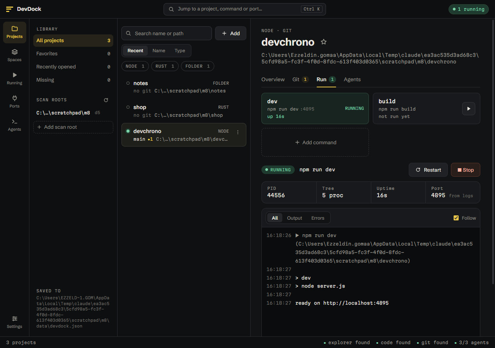
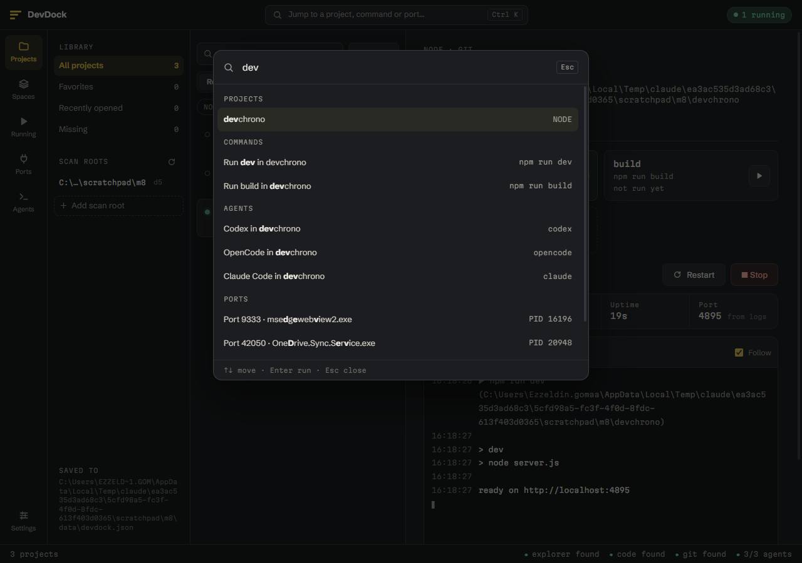

# DevDock

A Windows desktop control panel for the projects on your machine: find them, see their Git state,
run their dev servers, see who holds which port, start coding agents in them, and bring up a
whole workspace of services in order.


## Features

- **Projects** - add folders or scan roots; type detection (Next.js, Node, Rust, PHP, Docker Compose);
  favourites, recent, missing folders with Locate / Remove. Opens in your editor or Explorer.
- **Git** - branch, changed files, ahead/behind, last commit, remotes, worktrees; read-only, via the `git` CLI.
- **Run** - runs package scripts and custom commands in a Windows Job Object, so stopping a run
  (or closing DevDock) ends every child process. Live console, exit codes, detected ports.
- **Ports** - every listening TCP port with its process and owner (DevDock, external, system).
  Ending an external process always asks first; system processes are never offered.
- **Agents** - launches Claude Code, Codex, OpenCode and others in the project, in your terminal.
- **Workspaces** - several services with start order, health checks, timeouts and restart limits.
- **Command palette** - `Ctrl K` jumps to any project, command, agent, workspace or port.
- **Data** - one JSON file in `%APPDATA%\DevDock`, saved atomically with a `.bak`; export/import
  from Settings.

| Run | Ports |
|---|---|
|  |  |
| **Command palette** | **Settings** |
|  |  |

## Keyboard

| Key | Does |
|---|---|
| `Ctrl K` | Open / close the command palette |
| `Up` / `Down` | Move through the project or workspace list |
| `Enter` | Open the selected project's Overview, or run the palette hit |
| `Esc` | Close the palette or a dialog |
| `F5` | Refresh the current screen |

## Install

Download `DevDock_x.y.z_x64-setup.exe` from [Releases](https://github.com/ezzdin-atef/devdock/releases/latest).
It installs into `C:\Program Files\DevDock` and updates itself from then on.

## Build and run

Needs Windows 10/11, [Rust](https://rustup.rs) (stable, MSVC), Node 20+ and pnpm, and the
WebView2 runtime (built into Windows 11).

```bash
pnpm install
```

```bash
pnpm tauri dev
```

```bash
pnpm tauri build
```

The release build lands in `target/release/devdock.exe`, with installers under
`target/release/bundle/`.

To try DevDock without touching your real project list, point it at another folder:

```powershell
$env:DEVDOCK_DATA_DIR = "C:\temp\devdock-demo"; pnpm tauri dev
```

## Releasing

```bash
pnpm release patch
```

Bumps the version, writes `CHANGELOG.md`, tags and pushes; GitHub Actions builds and publishes
the installer and the in-app update. One-time setup and details: [docs/RELEASING.md](docs/RELEASING.md).

## Checks

The same checks CI runs on `windows-latest`:

```bash
cargo fmt --all --check
```

```bash
cargo clippy --workspace --all-targets -- -D warnings
```

```bash
cargo test --workspace
```

```bash
pnpm check
```

```bash
pnpm contrast
```

## Layout

| Path | What it is |
|---|---|
| `crates/devdock-core` | Domain logic: projects, detection, git, runs, ports, agents, workspaces, palette, persistence. No Tauri. |
| `crates/devdock-platform` | Windows FFI (Job Objects, TCP table, process details). The only crate with `unsafe`. |
| `src-tauri` | Thin Tauri commands and events over the core. |
| `src` | Svelte 5 UI. Calls typed wrappers in `src/lib/api.ts` only. |
| `docs` | Product, design, plan, tasks, decisions, states audit. |

Rust owns all state and user-facing error copy; the UI renders DTOs and sends commands. See
[docs/PLAN.md](docs/PLAN.md) for the architecture and [docs/decisions.md](docs/decisions.md) for
why things are the way they are.
