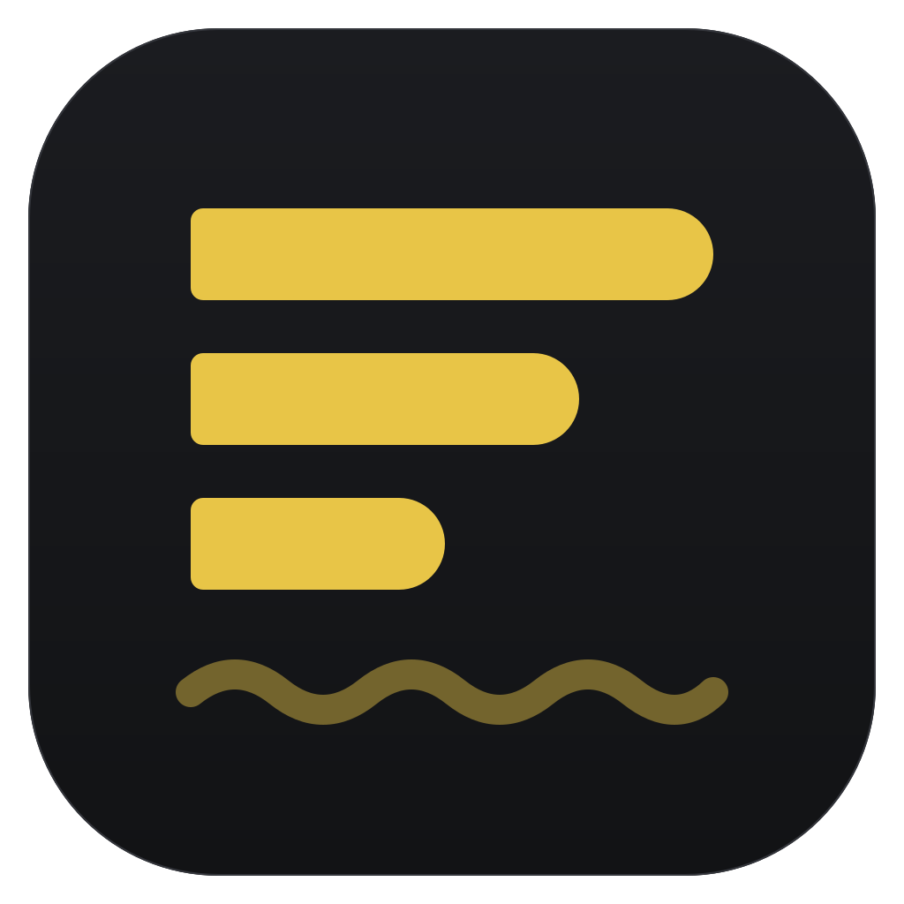
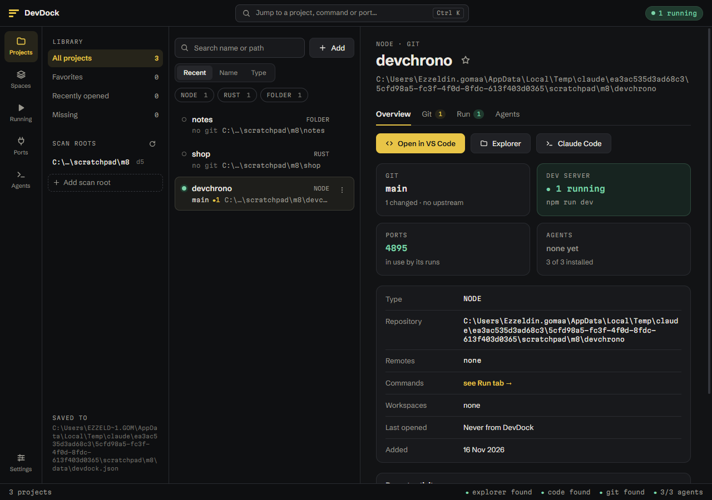

<div align="center">



# DevDock

**A local-first Windows control panel for every project on your machine.**

Find projects, see their Git state, run dev servers, see who holds which port, start coding
agents, and bring up whole stacks in order - all from one window.

[](https://github.com/ezzdin-atef/devdock/releases/latest)
[](https://github.com/ezzdin-atef/devdock/actions/workflows/ci.yml)
[](https://github.com/ezzdin-atef/devdock/releases)
[](#install)
[](https://tauri.app)
[](LICENSE)

[**Download**](https://github.com/ezzdin-atef/devdock/releases/latest) &middot;
[Website](https://ezzdin-atef.github.io/devdock/) &middot;
[Features](#features) &middot;
[Quick start](#quick-start) &middot;
[Changelog](CHANGELOG.md) &middot;
[Contributing](CONTRIBUTING.md)

<br>



</div>

---

## Why DevDock?

A normal day across several local projects costs small amounts of time, over and over:

- Finding the folder, then opening Explorer, the editor and a terminal one by one.
- Forgetting which branch a project is on, or whether it has uncommitted work.
- Running `npm run dev` in several terminals and losing track of what runs where.
- "Port 3000 is already in use" - with no quick way to see who holds it or whether it's safe to stop.
- Opening Claude Code or Codex, then `cd`-ing into the right folder first.
- Starting a database, API and frontend by hand, in the right order, every time.

DevDock turns each of these into one or two actions.

> [!NOTE]
> DevDock **organizes your tools instead of replacing them**. It is not an IDE, a Git client, a
> terminal or an AI chat app - every action ends in a real tool (Explorer, your editor, a
> terminal, an agent CLI) opened in the right folder. No accounts, no cloud, no telemetry.

## Highlights

| | |
|---|---|
| **Projects** | Add folders or scan roots; auto-detects Next.js, Node, Rust, PHP and Docker Compose. |
| **Git at a glance** | Branch, ahead/behind, changes, last commit, worktrees - strictly read-only. |
| **Run** | Package scripts and custom commands with live logs; stopping ends the whole process tree. |
| **Ports** | Every listening port, who owns it, and conflict checks before launch. |
| **Agents** | Launch Claude Code, Codex or OpenCode in the right folder and terminal. |
| **Workspaces** | Start multi-service stacks in order, with health checks and restart policies. |
| **Command palette** | `Ctrl K` to jump to anything: projects, commands, agents, ports. |
| **Self-updating** | Signed in-app updates from GitHub Releases. |

## Install

1. Download **`DevDock_x.y.z_x64-setup.exe`** from the
   [latest release](https://github.com/ezzdin-atef/devdock/releases/latest).
2. Run it. DevDock installs into `C:\Program Files\DevDock` (asks for admin once), adds a Start
   menu entry and registers `devdock` for `Win+R`.
3. That's it - from now on an **Update x.y.z** pill appears in the title bar when a new version
   is out.

The installer also installs the WebView2 runtime if it's missing (it's built into Windows 11).

> [!IMPORTANT]
> The installer isn't Authenticode-signed yet, so SmartScreen may show "Windows protected your
> PC" on first run: choose **More info -> Run anyway**. In-app updates are signed and verified.

To uninstall, use **Settings -> Apps**. The uninstaller offers to delete DevDock's data too.

<details>
<summary><b>Optional tools DevDock can use</b></summary>
<br>

DevDock uses what's already on your machine. **Settings** shows which tools were detected and
where.

| Tool | Used for |
|---|---|
| `git` | Git panel |
| An editor CLI (`code`, `cursor`, `code-insiders`, `windsurf`, `zed`) | Open in editor |
| Windows Terminal (`wt`), PowerShell, Git Bash | Terminal and agent launches (`cmd` always works) |
| `claude`, `codex`, `opencode` | Agents |
| Docker (with Compose) | Compose services in workspaces |
| Node package managers (npm, pnpm, yarn, bun) | Running package scripts |

</details>

## Quick start

1. **Add projects** - Projects -> add a folder, or Settings -> add a scan root like `D:\dev`.
2. **Open one** - `Ctrl K`, type part of its name, `Enter`. Click **VS Code** (or your editor).
3. **Run it** - Run tab -> start `dev`. Watch the console; the port appears once it's listening.
4. **Fix a port clash** - if the port is taken, the banner shows who holds it; pick another port
   or end the process after reviewing its details.
5. **Ask an agent** - Agents tab -> **Claude Code**. A terminal opens in the project folder.
6. **Bring up a stack** - Spaces -> create a workspace, add services (e.g. db, api, web) with
   health checks -> **Start all**.

## Features

### Projects

- Add a folder with the picker (or drop it onto the window), or add **scan roots** such as
  `D:\dev` and let DevDock find projects below them up to a chosen depth. Scans skip
  `node_modules`, `target`, `.next`, `vendor` and `.git`.
- **Type detection** from marker files:

  | Type | Detected by |
  |---|---|
  | Next.js | `package.json` + `next.config.*` |
  | Node | `package.json` |
  | Rust | `Cargo.toml` |
  | PHP | `composer.json` |
  | Docker Compose | `docker-compose.yml` / `compose.yml` (and `.yaml`) |

- Search by name or path, sort (recent, name, type), filter by type, favourites.
- Rename, remove (never touches the folder on disk), copy path. Paths are normalized, so the
  same folder can't be added twice.
- Missing folders are flagged with **Locate...** or **Remove**.
- Open in Explorer, your editor (VS Code, Cursor, VS Code Insiders, Windsurf or Zed), a
  terminal, or an agent.

### Git (read-only)

- Repository root, branch, upstream, ahead/behind.
- Staged, modified and untracked counts; last commit (hash, message, author, time); remotes;
  worktrees.
- Works for projects inside a shared repository (monorepos) and for Git worktrees.
- Reads through the `git` CLI and **never writes** to the repository.

### Run


- Lists `package.json` scripts (run with the project's package manager - npm, pnpm, yarn or
  bun, picked from the lockfile) and lets you add custom commands per project.
- Each run lives in a **Windows Job Object**, so stopping it - or quitting DevDock - ends the
  whole process tree, not just the shell. No orphaned `node.exe` left behind.
- Live console with stdout and stderr together, filter, follow output, highlighted stderr.
- States: running, stopped, exited (code), failed (code). Exit codes and detected ports are shown.
- The **Running** screen lists every process DevDock owns across projects and workspaces, with
  logs, stop, restart and **Stop everything**.

### Ports


- Every listening TCP port with its PID, process, matched project and owner:
  `DEVDOCK`, `EXTERNAL` or `SYSTEM`.
- **Conflict check before launch**: if a port a service needs is taken, DevDock shows who holds
  it and offers to start elsewhere, inspect the process, or end it.
- Ending an external process always asks first and shows its command line, folder, start time
  and child processes. System processes are never offered.

### Agents

- Detects **Claude Code** (`claude`), **Codex** (`codex`) and **OpenCode** (`opencode`) on
  `PATH` and shows where each was found. Missing ones show an install hint and **Re-check**.
- Launches the agent in **Windows Terminal**, **PowerShell**, **Git Bash** or **Command Prompt**,
  in the project root or a chosen subfolder.
- Bind up to nine launches to `Ctrl Alt 1`-`9` (works while DevDock is focused).

### Workspaces

A named group of services from one or more projects, started as one unit:

- Each service is either a project command (optionally in one of its Git worktrees) or a
  **Docker Compose** service.
- Start order, optional explicit dependencies, and a port for conflict checks.
- **Health checks**: TCP (something accepts a connection on the port) or HTTP `GET` (expects a
  given status, or any 2xx/3xx). Each service waits for the previous one to be healthy.
- **Restart policy**: restart on crash, by default up to 3 times in 5 minutes.
- Combined logs labelled by service, with per-service filters.
- **After start** preset: open the editor and/or an agent in a project once everything is up.

### Command palette


`Ctrl K` from anywhere: fuzzy search across projects, commands ("run dev in api"), agent
launches, workspaces and ports ("who's on 8069?").

### Settings


- Editor, terminal and default agent; detected tools; scan roots and depth.
- Dark and light themes, following Windows or chosen manually (toggle in the title bar).
- Data location, export and import.
- In-app updates from GitHub Releases (installed builds only).

## Keyboard shortcuts

| Key | Action |
|---|---|
| <kbd>Ctrl</kbd> + <kbd>K</kbd> | Open / close the command palette |
| <kbd>Up</kbd> / <kbd>Down</kbd> | Move through the project or workspace list |
| <kbd>Enter</kbd> | Open the selected project's Overview, or run the palette hit |
| <kbd>Esc</kbd> | Close the palette or a dialog |
| <kbd>F5</kbd> | Refresh the current screen |
| <kbd>Ctrl</kbd> + <kbd>Alt</kbd> + <kbd>1</kbd>-<kbd>9</kbd> | Run a bound agent / terminal launch |

## Safety rules

These are product invariants, not settings. DevDock will:

- **Never** end a process it didn't start without explicit confirmation showing full details.
- **Never** touch system processes.
- **Never** write to a Git repository.
- **Never** delete project folders - **Remove** only removes the entry from DevDock.
- **Always** stop the whole process tree of processes it owns. Quitting while runs are active
  asks first and then stops them all.
- **Never** guess port ownership from a port number or executable name alone.

## Data and privacy

Everything stays on your machine. All state lives in one JSON file, `devdock.json`, in
`%APPDATA%\DevDock`:

- Projects, favourites, custom commands, scan roots, workspaces, agent shortcuts and settings.
- Saved atomically (write then rename), debounced, with a `.bak` copy of the previous version.
- If the file is damaged, DevDock renames it to `devdock.json.corrupt-<time>` (never
  overwrites it), falls back to the `.bak`, and warns you.
- **Settings -> Data** shows the location and exports / imports the file.

Apart from the workspace health checks you configure, the only network request DevDock makes is
the update check against GitHub Releases.

| Environment variable | Effect |
|---|---|
| `DEVDOCK_DATA_DIR` | Use this folder for data instead of `%APPDATA%\DevDock` |

## Troubleshooting

<details>
<summary><b>Common problems and fixes</b></summary>
<br>

| Problem | Fix |
|---|---|
| "`code` not found on PATH" | Reinstall the editor with "Add to PATH", or pick another editor in Settings. |
| An agent shows "not installed" | Install it (e.g. `npm install -g @anthropic-ai/claude-code`), then **Re-check**. |
| Can't end a process on the Ports screen | It may need elevation; run DevDock as administrator. System processes are never offered. |
| Git panel is empty | Make sure `git` is on `PATH` and the folder is inside a repository. |
| SmartScreen warning on install | The installer isn't code-signed yet: **More info -> Run anyway**. |
| Startup warning about recovered data | The data file was damaged; the original is kept as `devdock.json.corrupt-<time>` in `%APPDATA%\DevDock`. |

</details>

Still stuck? [Open an issue](https://github.com/ezzdin-atef/devdock/issues/new) with your
DevDock version (Settings) and what you expected to happen.

## Tech stack

| Layer | Technology |
|---|---|
| Core | Rust (edition 2024) - all domain logic and state, no Tauri dependency |
| Platform | Windows FFI - Job Objects, TCP table, process details |
| Shell | [Tauri 2](https://tauri.app) with NSIS installer and signed updater |
| UI | [Svelte 5](https://svelte.dev) (SvelteKit, SPA mode) + TypeScript |

See [CONTRIBUTING.md](CONTRIBUTING.md#architecture) for the full architecture.

## Contributing

Contributions are welcome. [CONTRIBUTING.md](CONTRIBUTING.md) covers building from source, the
checks CI runs, the code layout and the release process. The short version:

```bash
pnpm install
```

```bash
pnpm tauri dev
```

## Documentation

| Document | Contents |
|---|---|
| [docs/PRODUCT.md](docs/PRODUCT.md) | Product spec, goals, flows, roadmap |
| [docs/DESIGN.md](docs/DESIGN.md) | Design system and UI rules |
| [docs/PLAN.md](docs/PLAN.md) | Architecture and implementation plan |
| [docs/TASKS.md](docs/TASKS.md) | Task breakdown |
| [docs/decisions.md](docs/decisions.md) | Why things are the way they are |
| [docs/states-audit.md](docs/states-audit.md) | Empty, loading and error states |
| [docs/RELEASING.md](docs/RELEASING.md) | Release process and updater |
| [CHANGELOG.md](CHANGELOG.md) | Release history |

## License

DevDock is released under the [MIT License](LICENSE).

<div align="center">
<br>
<sub>Built with Rust, Tauri and Svelte. If DevDock saves you time, consider giving it a star.</sub>
</div>
