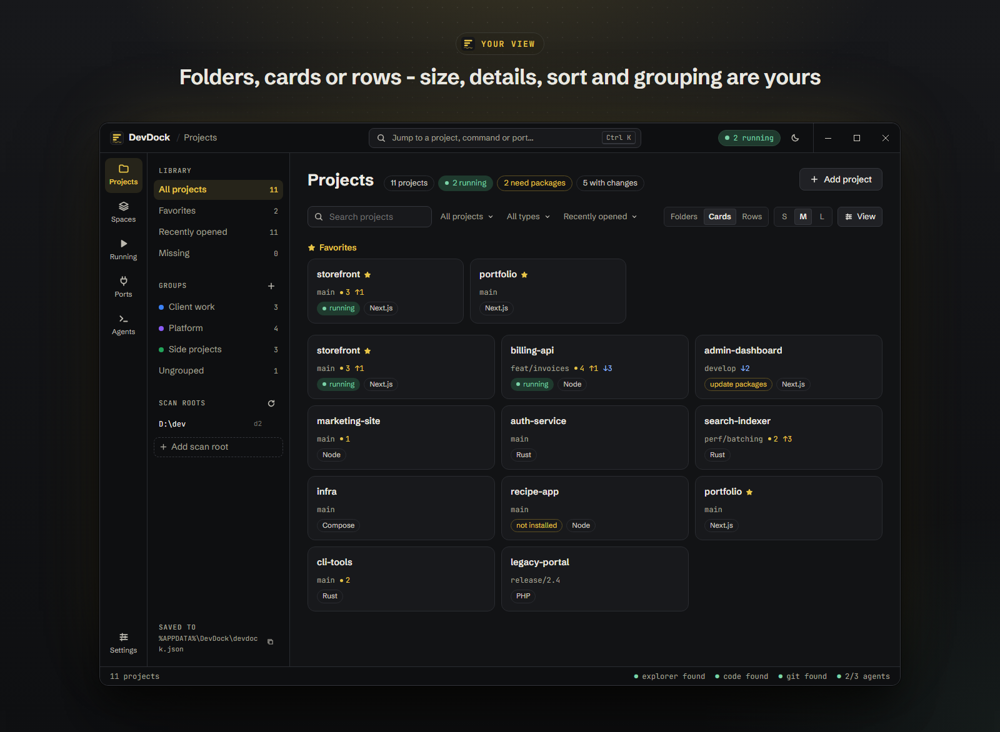
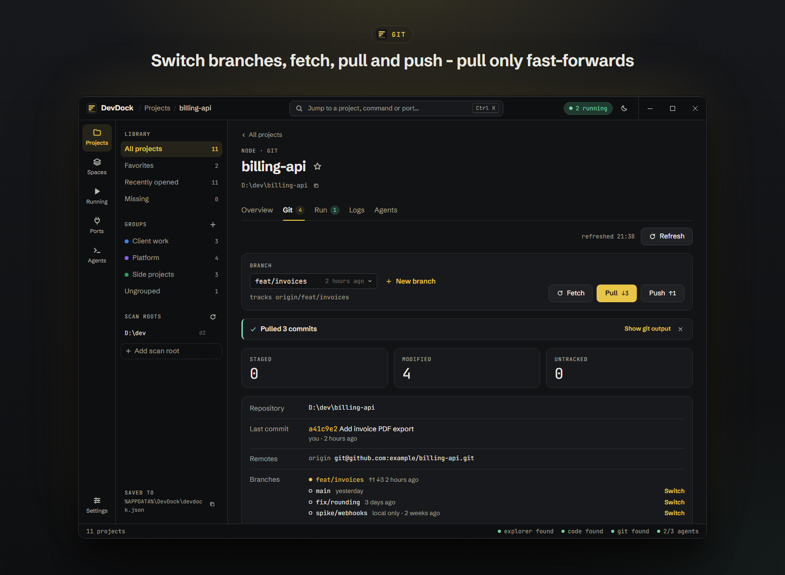
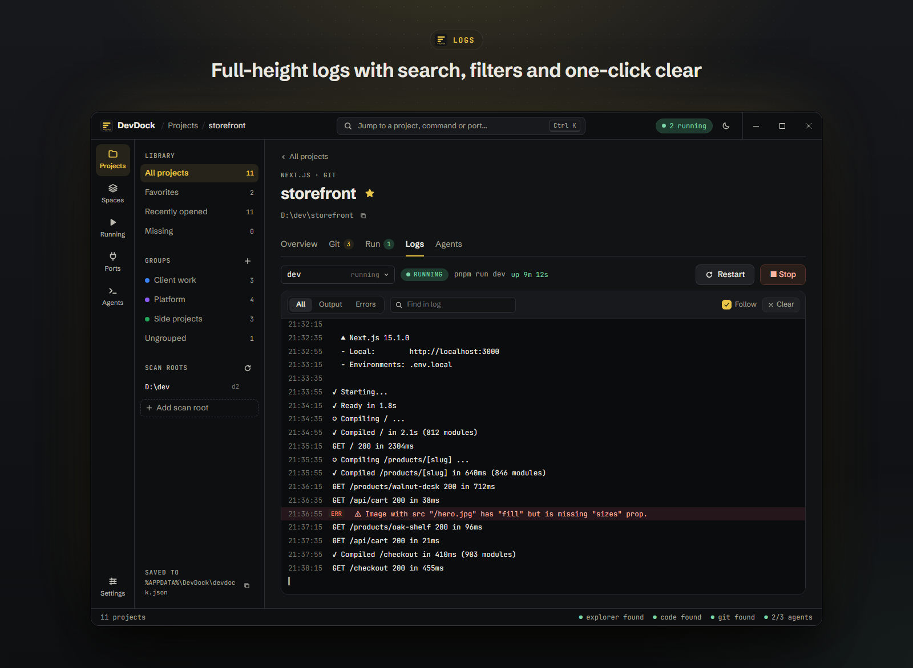
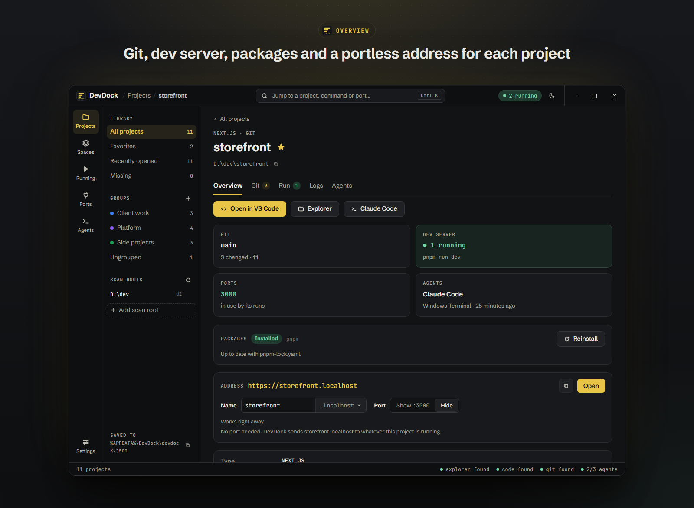
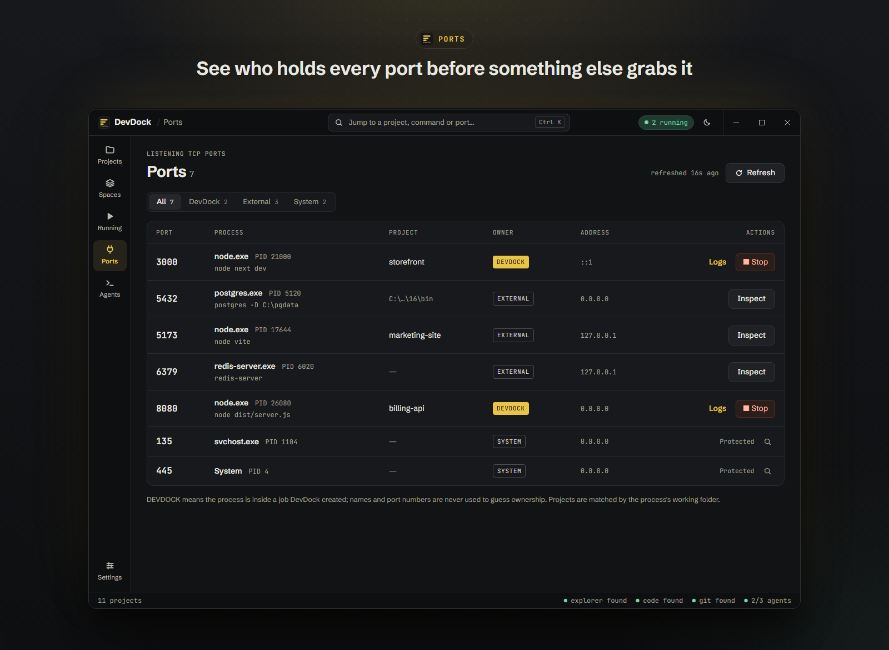
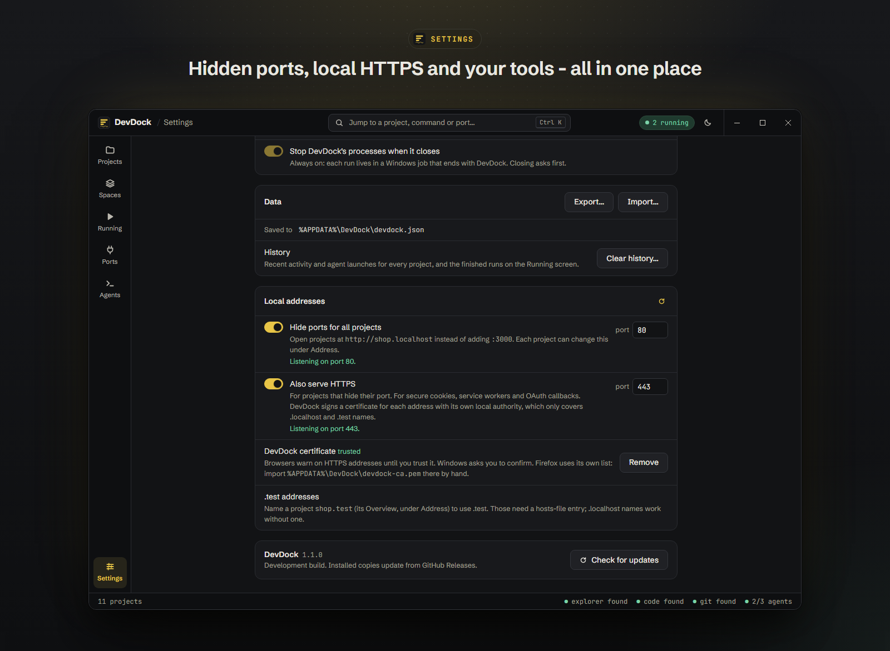

<div align="center">


# DevDock

**A local-first Windows control panel for every project on your machine.**

Organize projects into groups, run dev servers on clean addresses like `shop.localhost`,
switch and pull Git branches, install packages, see who holds which port, start coding agents,
and bring up whole stacks in order - all from one window.

[](https://github.com/ezzdin-atef/devdock/releases/latest)
[](https://github.com/ezzdin-atef/devdock/actions/workflows/ci.yml)
[](https://github.com/ezzdin-atef/devdock/releases)
[](#install)
[](https://tauri.app)
[](LICENSE)

[**Download**](https://github.com/ezzdin-atef/devdock/releases/latest) &middot;
[Website](https://ezzdin-atef.github.io/devdock/) &middot;
[What's new](#whats-new-in-11) &middot;
[Features](#features) &middot;
[Quick start](#quick-start) &middot;
[Changelog](CHANGELOG.md) &middot;
[Contributing](CONTRIBUTING.md)

<br>


</div>

---

## Why DevDock?

A normal day across several local projects costs small amounts of time, over and over:

- Finding the folder, then opening Explorer, the editor and a terminal one by one.
- Forgetting which branch a project is on, or whether it has uncommitted work.
- Running `npm run dev` in several terminals and losing track of what runs where.
- Every project fighting over `localhost:3000`, sharing cookies and breaking bookmarks.
- Running a project after a `git pull` and finding its packages are missing or out of date.
- "Port 3000 is already in use" - with no quick way to see who holds it or whether it's safe to stop.
- Opening Claude Code or Codex, then `cd`-ing into the right folder first.
- Starting a database, API and frontend by hand, in the right order, every time.

DevDock turns each of these into one or two actions.

> [!NOTE]
> DevDock **organizes your tools instead of replacing them**. It is not an IDE, a Git client, a
> terminal or an AI chat app - every action ends in a real tool (Explorer, your editor, a
> terminal, an agent CLI) opened in the right folder. No accounts, no cloud, no telemetry.

## What's new in 1.1

| | |
|---|---|
| **Projects page you shape** | Folders, cards or rows in three sizes; pick the details; group by your groups, folder or type. |
| **Groups and drag & drop** | Colour-coded groups (18 colours or any custom one); drag projects into groups, into your own order, and drag groups to reorder. |
| **Local addresses** | `shop.localhost` for every project, ports picked once and saved, the port hidden by a local proxy, optional HTTPS. |
| **Git actions** | Switch and create branches, fetch, pull (fast-forward only) and push, with git's own output. |
| **Packages** | See which projects need `npm` / `pnpm` / `yarn` / `bun install`, and install with one button. |
| **Logs and history** | A full-height Logs tab with search; clear logs, finished runs and history. |
| **Back and forward** | Mouse back / forward buttons and `Alt` + arrows step through where you've been. |

## Highlights

| | |
|---|---|
| **Projects** | Groups, layouts, drag & drop and your own order; auto-detects Next.js, Node, Rust, PHP and Docker Compose. |
| **Git** | Branch, ahead/behind, changes, last commit, worktrees - and switch, fetch, pull and push when you click. |
| **Run & logs** | Package scripts and custom commands on saved ports, with full-height logs; stopping ends the whole process tree. |
| **Local addresses** | `name.localhost` for every project, with the port hidden and optional HTTPS. |
| **Packages** | Install status for every project and a one-click install. |
| **Ports** | Every listening port, who owns it, and conflict checks before launch. |
| **Agents** | Launch Claude Code, Codex or OpenCode in the right folder and terminal. |
| **Workspaces** | Start multi-service stacks in order, with health checks and restart policies. |
| **Command palette** | `Ctrl K` to jump to anything: projects, commands, agents, ports. |
| **Self-updating** | Signed in-app updates from GitHub Releases. |

## Install

1. Download **`DevDock_x.y.z_x64-setup.exe`** from the
   [latest release](https://github.com/ezzdin-atef/devdock/releases/latest).
2. Run it. DevDock installs into `C:\Program Files\DevDock` (asks for admin once), adds a Start
   menu entry and registers `devdock` for `Win+R`.
3. That's it - from now on an **Update x.y.z** pill appears in the title bar when a new version
   is out.

The installer also installs the WebView2 runtime if it's missing (it's built into Windows 11).

> [!IMPORTANT]
> The installer isn't Authenticode-signed yet, so SmartScreen may show "Windows protected your
> PC" on first run: choose **More info -> Run anyway**. In-app updates are signed and verified.

To uninstall, use **Settings -> Apps**. The uninstaller offers to delete DevDock's data too.

<details>
<summary><b>Optional tools DevDock can use</b></summary>
<br>

DevDock uses what's already on your machine. **Settings** shows which tools were detected and
where.

| Tool | Used for |
|---|---|
| `git` | Git tab: status, branches, fetch, pull, push |
| An editor CLI (`code`, `cursor`, `code-insiders`, `windsurf`, `zed`) | Open in editor |
| Windows Terminal (`wt`), PowerShell, Git Bash | Terminal and agent launches (`cmd` always works) |
| `claude`, `codex`, `opencode` | Agents |
| Docker (with Compose) | Compose services in workspaces |
| Node package managers (npm, pnpm, yarn, bun) | Running package scripts and installing packages |

</details>

## Quick start

1. **Add projects** - add a folder with **Add project**, or a scan root like `D:\dev` in the
   sidebar.
2. **Organize** - press **+** next to **Groups**, name the group, and drag projects into it.
3. **Open one** - click its card (or `Ctrl K`, type part of its name, `Enter`), then click
   **VS Code** (or your editor).
4. **Install and run** - if the project shows **not installed**, click **Install** in its
   Overview. Then Run tab -> start `dev` and open its address, like `storefront.localhost`.
5. **Pull the latest** - Git tab -> **Pull**. Switch branches from the branch picker.
6. **Ask an agent** - Agents tab -> **Claude Code**. A terminal opens in the project folder.
7. **Bring up a stack** - Spaces -> create a workspace, add services (e.g. db, api, web) with
   health checks -> **Start all**.

## Features

### Projects



- **One page for everything**: every project as a card. Click one to open it full width; go
  back with the **All projects** link, `Esc`, or your mouse's back button.
- **Layouts**: folder cards (one per group or folder), project cards or compact rows, in small,
  medium or large. The **View** menu picks what each project shows: running state, Git, packages
  status, type, last opened, path. A favourites row sits on top. Your choices are remembered.
- **Groups** work like folders: name them, pick one of 18 colours or any custom colour, and
  reorder them by dragging. Click a group in the sidebar to see just its projects.
- **Drag and drop**: drop a project on a group (or on **Drop here for a new group**), or between
  two projects to set your own order (the page switches to **Manual order**).
- Group the page by your groups, by folder on disk or by type, or show everything in one grid.
  Sort by recent, name, type or manual order. Search and filter by type.
- Add a folder with the picker (or drop it onto the window), or add **scan roots** such as
  `D:\dev` and let DevDock find projects below them up to a chosen depth. Scans skip
  `node_modules`, `target`, `.next`, `vendor` and `.git`.
- **Type detection** from marker files:

  | Type | Detected by |
  |---|---|
  | Next.js | `package.json` + `next.config.*` |
  | Node | `package.json` |
  | Rust | `Cargo.toml` |
  | PHP | `composer.json` |
  | Docker Compose | `docker-compose.yml` / `compose.yml` (and `.yaml`) |

- Right-click any project for its menu: open, rename, move to a group, copy path, favourite,
  show in Explorer, remove (never touches the folder on disk). Paths are normalized, so the
  same folder can't be added twice. Missing folders are flagged with **Locate...** or **Remove**.

### Git



- Repository root, branch, upstream, ahead/behind; staged, modified and untracked counts; last
  commit; remotes; worktrees; every branch with its upstream.
- **Switch branches** from a searchable picker, or check out a remote branch (a local tracking
  branch is created). **New branch** creates one from where you are and switches to it.
- **Fetch**, **Pull** and **Push**, with the counts on the buttons. A first push sets the
  upstream. Each action shows a plain result ("Pulled 3 commits") and git's own output.
- **Pull only fast-forwards.** If your branch and the remote have both changed, DevDock says so
  and changes nothing; merge or rebase in a terminal. It never merges, rebases, commits, resets
  or stashes on its own.
- Works for projects inside a shared repository (monorepos) and for Git worktrees.

### Run and logs


- Lists `package.json` scripts (run with the project's package manager - npm, pnpm, yarn or
  bun, picked from the lockfile) and lets you add custom commands per project.
- **Ports per command**: the server's own default, **auto** (a free port picked once and saved,
  so bookmarks keep working) or **fixed**. DevDock sets `PORT` and adds `--port` for tools that
  need it (Vite, Astro, Angular, Nuxt, webpack, ...). Turn auto on for all commands in Settings.
- Each run lives in a **Windows Job Object**, so stopping it - or quitting DevDock - ends the
  whole process tree, not just the shell. No orphaned `node.exe` left behind.
- A full-height **Logs** tab with search, stdout / stderr filters and follow.
- **Clear** a log, forget a finished run, clear a project's activity, or clear all history
  (and optionally learned ports) from Settings -> Data.
- The **Running** screen lists every process DevDock owns across projects and workspaces, with
  logs, stop, restart, **Clear finished** and **Stop everything**.



### Local addresses



- Every project gets an address like `storefront.localhost`. Browsers send `*.localhost` to your
  own machine with no setup, and each address is its own site, so cookies and storage no longer
  leak between projects.
- **Hide the port** (on by default): a small proxy built into DevDock answers on port 80 and
  forwards each name to whatever that project is running, so you open `http://storefront.localhost`.
  It listens only on this computer. If another server already holds IPv4 port 80, DevDock
  shares it over IPv6, which browsers try first.
- **HTTPS**: DevDock signs a certificate for each address with its own local certificate
  authority. That authority is limited to `.localhost` and `.test` names, so it can't vouch for
  any real website. Trusting it shows Windows' own confirmation dialog; you can remove it again
  in Settings.
- Prefer `.test`? Pick the ending next to the name. DevDock adds it to the hosts file after a
  Windows permission prompt.
- Change the name, ending and port setting in each project's **Overview -> Address**.

### Packages

- For Node projects, DevDock checks whether packages are **installed**, **not installed** or
  **out of date** (the lockfile changed after the last install - for example after a pull).
  Only file checks; nothing runs.
- Works with npm, pnpm, yarn (including Plug'n'Play) and bun, picked from the lockfile.
- The project card shows it, and the project's Overview has an **Install** / **Update** button
  that streams the log right there. The install also shows under Run, Logs and Running.

### Ports



- Every listening TCP port with its PID, process, matched project and owner:
  `DEVDOCK`, `EXTERNAL` or `SYSTEM`.
- **Conflict check before launch**: if a port a service needs is taken, DevDock shows who holds
  it and offers to start elsewhere, inspect the process, or end it.
- Ending an external process always asks first and shows its command line, folder, start time
  and child processes. System processes are never offered.

### Agents

- Detects **Claude Code** (`claude`), **Codex** (`codex`) and **OpenCode** (`opencode`) on
  `PATH` and shows where each was found. Missing ones show an install hint and **Re-check**.
- Launches the agent in **Windows Terminal**, **PowerShell**, **Git Bash** or **Command Prompt**,
  in the project root or a chosen subfolder.
- Bind up to nine launches to `Ctrl Alt 1`-`9` (works while DevDock is focused).

### Workspaces

A named group of services from one or more projects, started as one unit:

- Each service is either a project command (optionally in one of its Git worktrees) or a
  **Docker Compose** service.
- Start order, optional explicit dependencies, and a port for conflict checks.
- **Health checks**: TCP (something accepts a connection on the port) or HTTP `GET` (expects a
  given status, or any 2xx/3xx). Each service waits for the previous one to be healthy.
- **Restart policy**: restart on crash, by default up to 3 times in 5 minutes.
- Combined logs labelled by service, with per-service filters.
- **After start** preset: open the editor and/or an agent in a project once everything is up.

### Command palette


`Ctrl K` from anywhere: fuzzy search across projects, commands ("run dev in api"), agent
launches, workspaces and ports ("who's on 8069?").

### Settings



- Editor, terminal and default agent; detected tools; scan roots and depth.
- Local addresses: hide ports for all projects, the proxy and HTTPS ports, trust or remove the
  certificate, and update the hosts file for `.test` names.
- Dark and light themes, following Windows or chosen manually (toggle in the title bar).
- Data location, export and import, and **Clear history**.
- In-app updates from GitHub Releases (installed builds only).

## Keyboard shortcuts

| Key | Action |
|---|---|
| <kbd>Ctrl</kbd> + <kbd>K</kbd> | Open / close the command palette |
| <kbd>Up</kbd> / <kbd>Down</kbd> | Step to the previous / next project while one is open |
| <kbd>Enter</kbd> | Open the selected project's Overview, or run the palette hit |
| <kbd>Esc</kbd> | Back to all projects; close the palette, a menu or a dialog |
| Mouse back / forward, <kbd>Alt</kbd> + <kbd>Left</kbd> / <kbd>Right</kbd> | Go back and forward through projects, groups, tabs and screens |
| <kbd>F5</kbd> | Refresh the current screen |
| <kbd>Ctrl</kbd> + <kbd>Alt</kbd> + <kbd>1</kbd>-<kbd>9</kbd> | Run a bound agent / terminal launch |

## Safety rules

These are product invariants, not settings. DevDock will:

- **Never** end a process it didn't start without explicit confirmation showing full details.
- **Never** touch system processes.
- **Never** change a Git repository unless you click an action. Pull only fast-forwards; DevDock
  never merges, rebases, commits, resets or stashes.
- **Never** delete project folders - **Remove** only removes the entry from DevDock.
- **Always** stop the whole process tree of processes it owns. Quitting while runs are active
  asks first and then stops them all.
- **Never** guess port ownership from a port number or executable name alone.
- **Never** change Windows settings without asking: the hosts file needs your OK in the Windows
  permission prompt, and trusting the certificate shows Windows' own dialog.
- **Keep local addresses local**: the proxy listens only on this computer, and DevDock's
  certificate authority can only sign `.localhost` and `.test` names.

## Data and privacy

Everything stays on your machine. All state lives in one JSON file, `devdock.json`, in
`%APPDATA%\DevDock`:

- Projects and their order, groups, favourites, custom commands and port choices, addresses,
  scan roots, workspaces, agent shortcuts and settings.
- HTTPS uses `devdock-ca.pem` and its key in the same folder. View preferences (layout, size,
  details) are kept by the app window itself.
- Saved atomically (write then rename), debounced, with a `.bak` copy of the previous version.
- If the file is damaged, DevDock renames it to `devdock.json.corrupt-<time>` (never
  overwrites it), falls back to the `.bak`, and warns you.
- **Settings -> Data** shows the location and exports / imports the file.

Apart from the workspace health checks you configure, DevDock only goes online for the update
check against GitHub Releases and for the Git fetch, pull and push you click (to your own
remotes). The local-address proxy listens only on this computer.

| Environment variable | Effect |
|---|---|
| `DEVDOCK_DATA_DIR` | Use this folder for data instead of `%APPDATA%\DevDock` |

## Troubleshooting

<details>
<summary><b>Common problems and fixes</b></summary>
<br>

| Problem | Fix |
|---|---|
| "`code` not found on PATH" | Reinstall the editor with "Add to PATH", or pick another editor in Settings. |
| An agent shows "not installed" | Install it (e.g. `npm install -g @anthropic-ai/claude-code`), then **Re-check**. |
| Can't end a process on the Ports screen | It may need elevation; run DevDock as administrator. System processes are never offered. |
| Git panel is empty | Make sure `git` is on `PATH` and the folder is inside a repository. |
| Pull says the branches have both changed | Your branch and the remote diverged. DevDock only fast-forwards; merge or rebase in a terminal. |
| The port still shows in the address | The proxy couldn't start. The project's Address panel says why; usually another program holds port 80 - pick another proxy port in Settings -> Local addresses. |
| Browser warns on an `https://...localhost` address | Trust DevDock's certificate in Settings -> Local addresses. Firefox has its own list: import `devdock-ca.pem` there. |
| A `.test` address doesn't open | It needs a hosts-file entry: click **Add it** in the project's Address panel, or **Update hosts file** in Settings. |
| SmartScreen warning on install | The installer isn't code-signed yet: **More info -> Run anyway**. |
| Startup warning about recovered data | The data file was damaged; the original is kept as `devdock.json.corrupt-<time>` in `%APPDATA%\DevDock`. |

</details>

Still stuck? [Open an issue](https://github.com/ezzdin-atef/devdock/issues/new) with your
DevDock version (Settings) and what you expected to happen.

## Tech stack

| Layer | Technology |
|---|---|
| Core | Rust (edition 2024) - all domain logic and state, no Tauri dependency |
| Platform | Windows FFI - Job Objects, TCP table, process details |
| Shell | [Tauri 2](https://tauri.app) with NSIS installer and signed updater |
| UI | [Svelte 5](https://svelte.dev) (SvelteKit, SPA mode) + TypeScript |

See [CONTRIBUTING.md](CONTRIBUTING.md#architecture) for the full architecture.

## Contributing

Contributions are welcome. [CONTRIBUTING.md](CONTRIBUTING.md) covers building from source, the
checks CI runs, the code layout and the release process. The short version:

```bash
pnpm install
```

```bash
pnpm tauri dev
```

The screenshots in this README are captured from the real UI with made-up demo data
(`scripts/screenshots/demo-bridge.js`). To refresh and frame them:

```bash
pnpm screenshots
```

## Documentation

| Document | Contents |
|---|---|
| [docs/PRODUCT.md](docs/PRODUCT.md) | Product spec, goals, flows, roadmap |
| [docs/DESIGN.md](docs/DESIGN.md) | Design system and UI rules |
| [docs/PLAN.md](docs/PLAN.md) | Architecture and implementation plan |
| [docs/TASKS.md](docs/TASKS.md) | Task breakdown |
| [docs/decisions.md](docs/decisions.md) | Why things are the way they are |
| [docs/states-audit.md](docs/states-audit.md) | Empty, loading and error states |
| [docs/RELEASING.md](docs/RELEASING.md) | Release process and updater |
| [CHANGELOG.md](CHANGELOG.md) | Release history |

## License

DevDock is released under the [MIT License](LICENSE).

<div align="center">
<br>
<sub>Built with Rust, Tauri and Svelte. If DevDock saves you time, consider giving it a star.</sub>
</div>
